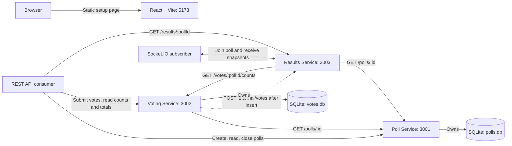
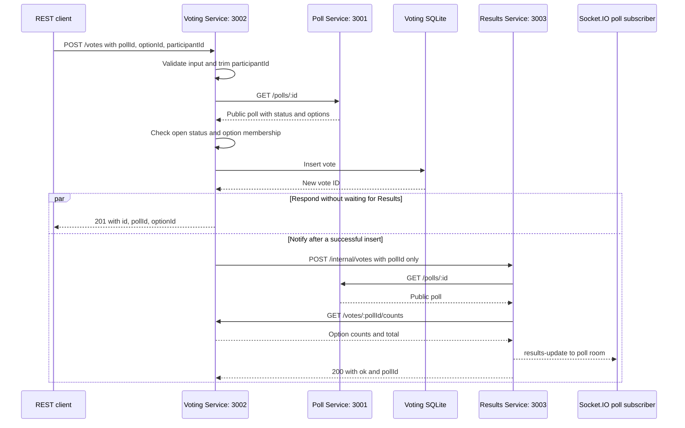

# Architecture

The application contains one React client and three independent Express
services. Each has its own `package.json` and runs on a dedicated development
port. Backend CORS allows `http://localhost:5173` by default.

## Current runtime

The React page currently makes no API or socket requests. REST and Socket.IO
consumers in the diagram represent separate API tools or the documented Node
example. All three services expose `/health`. Results uses one HTTP server for
Express routes and Socket.IO; it has no database or stored results cache.

## Data ownership

| Owner | Default file | Tables and important constraints |
| --- | --- | --- |
| Poll Service | `services/poll-service/data/polls.db` | `polls`: unique room code, status, question, host-token hash; `poll_options`: stable IDs, poll foreign key, text, and option order |
| Voting Service | `services/voting-service/data/votes.db` | `votes`: ID, poll ID, option ID, participant ID; `UNIQUE (poll_id, participant_id)` |
| Results Service | None | Reads the owning services' REST APIs for each snapshot |

Both active databases use SQLite WAL and keep data across service restarts.
`DATABASE_PATH` can override each file; relative paths resolve from the owning
service's folder. The Voting Service never reads the Poll database. Poll and
option IDs in its database are checked through the Poll REST API, rather than
through foreign keys across database files.

## Voting and live results flow

The following sequence assumes a valid request for an existing, open poll with
a matching option:

The unique constraint rejects duplicate votes with 409, including simultaneous
requests, before the notification step. Participant
IDs are trimmed and case-sensitive; clients must reuse the same ID for this
protection to work. No participant authentication is implemented.

Missing polls, closed polls, invalid options, and unavailable Poll Service
requests stop the flow before insertion. The Poll request has a three-second
timeout, including its response body. Checking that a poll is open and inserting
the vote occur in different services: a host can close the poll between those
steps because there is no transaction spanning both services.

Count and total endpoints also consult the Poll API to confirm the poll exists.
Counts include zero-vote options in Poll Service order, and closed polls remain
readable. These reads require the Poll Service to be available.

Results combines poll details and counts into a full snapshot with percentages
rounded to two decimal places. Zero-vote options remain in poll order. Each
upstream request has a three-second timeout including its body. Joins and
notification broadcasts are serialized per poll so an older lookup cannot
overwrite a newer broadcast.

## Socket rooms and delivery

A socket joins one `poll:<id>` room. `join-poll` or a handshake `auth.pollId`
triggers a fresh lookup and snapshot. Joining a different poll leaves the previous
room, even if the new request is invalid. Disconnecting leaves all rooms; pending
lookups cannot later join or deliver an old room to that socket.

Using handshake `auth: { pollId }` rejoins automatically on each connection and
reconnection. A client can instead emit `join-poll` inside every `connect`
handler. Lookup failures are reported through `results-error` and an optional
join acknowledgement. No Socket.IO user authentication is added.

Vote notifications have a two-second timeout and are best-effort. A failed
notification is logged without changing the accepted vote's 201 response. There
is no retry queue, broker, or Results database. A GET, rejoin, reconnect, or later
successful notification reads current stored data and recovers missed updates.

## Host access and planned work

There are no user accounts. Poll creation returns a host token once, and only
its SHA-256 hash is stored. Closing a poll requires that token in an
`Authorization: Bearer` header. Public poll reads do not return tokens or hashes.

Connecting the React client to the implemented APIs and Socket.IO stream, and
rendering Recharts results, remain planned work. The static page is unchanged.

See the [project description](project-description.md), [API reference](api.md),
and [root README](../README.md) for scope, endpoint contracts, and startup commands.
