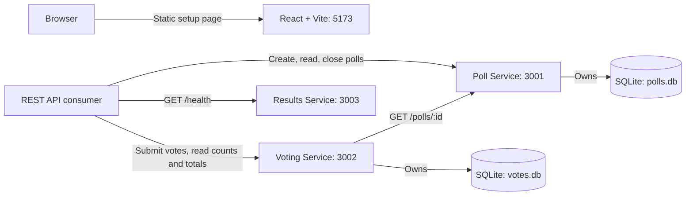
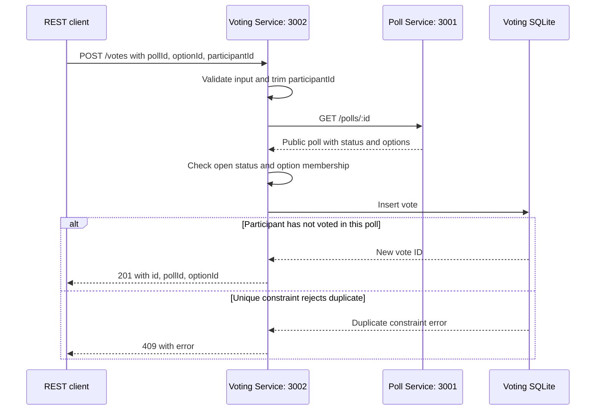

# Architecture

The application contains one React client and three independent Express
services. Each has its own `package.json` and runs on a dedicated development
port. Backend CORS allows `http://localhost:5173` by default.

## Current runtime

The React page currently makes no API or socket requests. The REST consumer in
the diagram represents tools such as PowerShell or an API client. The Results
Service only exposes `/health`; it has no results endpoints or socket handlers.
Poll and Voting Services also expose `/health`.

## Data ownership

| Owner | Default file | Tables and important constraints |
| --- | --- | --- |
| Poll Service | `services/poll-service/data/polls.db` | `polls`: unique room code, status, question, host-token hash; `poll_options`: stable IDs, poll foreign key, text, and option order |
| Voting Service | `services/voting-service/data/votes.db` | `votes`: ID, poll ID, option ID, participant ID; `UNIQUE (poll_id, participant_id)` |
| Results Service | None in use | No database is opened by the current implementation |

Both active databases use SQLite WAL and keep data across service restarts.
`DATABASE_PATH` can override each file; relative paths resolve from the owning
service's folder. The Voting Service never reads the Poll database. Poll and
option IDs in its database are checked through the Poll REST API, rather than
through foreign keys across database files.

## Voting request flow

The following sequence assumes a valid request for an existing, open poll with
a matching option:

The unique constraint also handles simultaneous duplicate requests. Participant
IDs are trimmed and case-sensitive; clients must reuse the same ID for this
protection to work. No participant authentication is implemented.

Missing polls, closed polls, invalid options, and unavailable Poll Service
requests stop the flow before insertion. The Poll request has a three-second
timeout, including its response body. Checking that a poll is open and inserting
the vote occur in different services: a host can close the poll between those
steps because there is no transaction spanning both services.

Count and total endpoints also consult the Poll API to confirm the poll exists.
Counts include zero-vote options in Poll Service order, and closed polls remain
readable. These reads require the Poll Service to be available.

## Host access and planned work

There are no user accounts. Poll creation returns a host token once, and only
its SHA-256 hash is stored. Closing a poll requires that token in an
`Authorization: Bearer` header. Public poll reads do not return tokens or hashes.

Connecting the React client, implementing Results Service behavior, emitting
Socket.IO events, and rendering Recharts results remain planned work. Installed
Socket.IO and Recharts packages do not imply those flows are active.

See the [project description](project-description.md), [API reference](api.md),
and [root README](../README.md) for scope, endpoint contracts, and startup commands.
