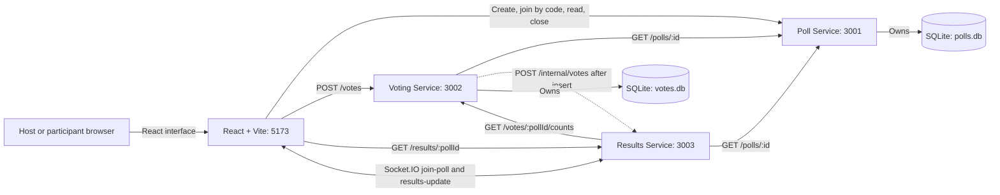
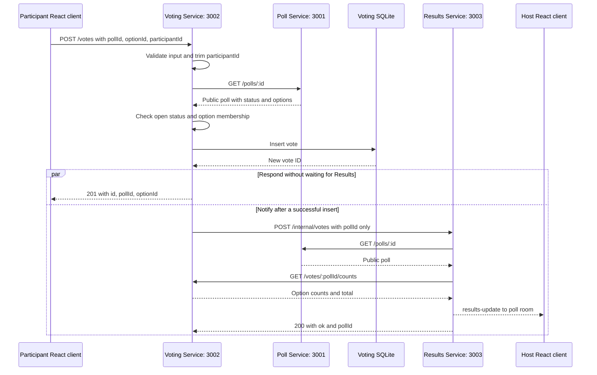

# Architecture

The application contains one React client and three independent Express
services. Each has its own `package.json` and runs on a dedicated development
port. Backend CORS allows `http://localhost:5173` by default.

## Current runtime

Vite serves the React application; its API and Socket.IO calls run in the
browser. Hash routes provide home, create, join, participant, and host screens
without a router dependency. All three services expose `/health`. Results uses
one HTTP server for Express routes and Socket.IO, with no database or stored
results cache. The final project retains these three service boundaries.

## Data ownership

| Owner | Default file | Tables and important constraints |
| --- | --- | --- |
| Poll Service | `services/poll-service/data/polls.db` | `polls`: unique room code, status, question, host-token hash; `poll_options`: stable IDs, poll foreign key, text, and option order |
| Voting Service | `services/voting-service/data/votes.db` | `votes`: ID, poll ID, option ID, participant ID; `UNIQUE (poll_id, participant_id)` |
| Results Service | None | Reads the owning services' REST APIs for each snapshot |

Both active databases use SQLite WAL and keep data across service restarts.
`DATABASE_PATH` can override each file; relative paths resolve from the owning
service's folder. The Voting Service never reads the Poll database. Poll and
option IDs in its database are checked through the Poll REST API, rather than
through foreign keys across database files.

## Voting and live results flow

The following sequence assumes a valid request for an existing, open poll with
a matching option:

The unique constraint rejects duplicate votes with 409, including simultaneous
requests, before the notification step. Participant
IDs are trimmed and case-sensitive; clients must reuse the same ID for this
protection to work. No participant authentication is implemented.

Missing polls, closed polls, invalid options, and unavailable Poll Service
requests stop the flow before insertion. The Poll request has a three-second
timeout, including its response body. Checking that a poll is open and inserting
the vote occur in different services: a host can close the poll between those
steps because there is no transaction spanning both services.

Count and total endpoints also consult the Poll API to confirm the poll exists.
Counts include zero-vote options in Poll Service order, and closed polls remain
readable. These reads require the Poll Service to be available.

Results combines poll details and counts into a full snapshot with percentages
rounded to two decimal places. Zero-vote options remain in poll order. Each
upstream request has a three-second timeout including its body. Joins and
notification broadcasts are serialized per poll so an older lookup cannot
overwrite a newer broadcast.

## Socket rooms and delivery

A socket joins one `poll:<id>` room. `join-poll` or a handshake `auth.pollId`
triggers a fresh lookup and snapshot. Joining a different poll leaves the previous
room, even if the new request is invalid. Disconnecting leaves all rooms; pending
lookups cannot later join or deliver an old room to that socket.

Using handshake `auth: { pollId }` rejoins automatically on each connection and
reconnection. The React host screen uses the alternative: it emits `join-poll`
inside every `connect` handler, including reconnects. Lookup failures are
reported through `results-error` and an optional join acknowledgement. No
Socket.IO user authentication is added.

The host starts a REST snapshot request alongside its Socket.IO connection and
consumes `results-update` snapshots. A nondecreasing total-vote guard prevents a
stale REST response from replacing newer socket data; a poll already marked
closed is not reopened by a stale snapshot. A delayed closed snapshot still
closes the display while retaining any newer counts. Manual refresh and retry restart
the result connection and request. Recharts and result rows show option counts
and percentages without a periodic polling interval.

Vote notifications have a two-second timeout and are best-effort. A failed
notification is logged without changing the accepted vote's 201 response. There
is no retry queue, broker, or Results database. A GET, rejoin, reconnect, or later
successful notification reads current stored data and recovers missed updates.

## Browser state and host access

There are no user accounts. Poll creation returns a host token once, and only
its SHA-256 hash is stored. Closing a poll requires that token in an
`Authorization: Bearer` header. Public poll reads do not return tokens or hashes.

| Browser storage | Key | Purpose |
| --- | --- | --- |
| `sessionStorage` | `lpr.host.<pollId>` | Full creation response, including the host token, for the creating tab's host controls |
| `localStorage` | `lpr.participantId` | Stable anonymous participant ID |
| `localStorage` | `lpr.vote.<pollId>` | Vote receipt for confirmation after reload |

Host tokens are never placed in URLs or local storage. If session storage
cannot save the creation response, host controls work from memory for that page
session but cannot be restored by refreshing. Keep the creating tab open for
host controls. The participant form requires working local storage rather than
generating a different identity on every request. Clearing storage or using a
new browser creates another anonymous identity; it is not proof of a person.

Client requests time out after ten seconds, including the body. Participants
reread the poll when the window regains focus, the document becomes visible,
and before submitting a vote. Poll closing has no backend socket broadcast:
those reads and the closed-poll 409 path update participant status. Hosts update
their own closed state after the authorized close request.

## Isolated system verification (Part 6)

The integration helper starts the same four applications as child processes,
using free ports, injected service/client URLs, and separate temporary Poll and
Voting SQLite files. It owns only those processes and test files. Real service
restarts exercise persistence and Socket.IO reconnection without touching normal
development data. The [integration guide](integration-testing.md) distinguishes
HTTP/socket tests, static React checks, and manual browser verification.

## Final review (Part 7)

The final package inventory confirms exactly three service packages and one
React client, each with its own lockfile. Results has no SQLite dependency or
database. The two SQLite owners and the REST/Socket.IO connections above were
reverified by the final automated run: 64 tests passed, 0 failed, and the client
production build passed. All architecture diagrams in the repository use Mermaid.

See the [submission guide](submission-guide.md) for installation and a professor
demonstration, including browser checks that remain manual.

See the [project description](project-description.md), [API reference](api.md),
and [client guide](../client/README.md) for scope, endpoint contracts, and browser
state. The [root README](../README.md) lists startup commands.
